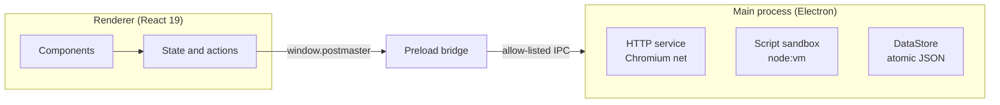

<div align="center">


# Postmaster

**A lightweight, local-first desktop API client.**
Build, send and debug HTTP requests with no account, no cloud and no telemetry.

<br />

[](https://github.com/niladri-1/postmaster/releases)
[](LICENSE)
[](#-getting-started)
[](https://github.com/niladri-1/postmaster/stargazers)


<br />

[Features](#-features) •
[Getting Started](#-getting-started) •
[Scripting](#-scripting) •
[Architecture](#-architecture) •
[Security](#-security) •
[Roadmap](#-roadmap) •
[Author](#-author)

<br />


</div>

<br />

## ✨ Why Postmaster

Postmaster keeps the workflow you already know (collections, environments, tabs, scripts) and removes everything else. Your data stays on your machine, startup is instant, and the whole codebase is small enough to read in an afternoon.

<table>
  <tr>
    <td align="center" width="25%"><b>🔒 Local-first</b><br/><sub>Everything is stored on your disk</sub></td>
    <td align="center" width="25%"><b>⚡ Fast</b><br/><sub>Chromium network stack, windowed viewer for huge responses</sub></td>
    <td align="center" width="25%"><b>🧩 Familiar</b><br/><sub>Imports Postman and OpenAPI files</sub></td>
    <td align="center" width="25%"><b>🛡️ Hardened</b><br/><sub>Sandboxed renderer, validated IPC</sub></td>
  </tr>
</table>

<br />

## 🚀 Features

| | Feature | Details |
|---|---|---|
| 🌐 | **Request builder** | Method picker, URL autocomplete from history and collections, dev shortcuts such as `localhost:3000` |
| 🔁 | **Params sync** | Query params and URL stay in sync both ways, with an always-present empty row |
| 🧾 | **Bodies** | JSON, raw, `x-www-form-urlencoded` and `form-data` (text fields) |
| 🔑 | **Authorization** | Basic, Bearer token and API key (header or query) |
| 📁 | **Collections** | Folders, drag and drop across folders and collections, right-click rename, duplicate and delete |
| 💾 | **One-click save** | `Save` updates in place; the `▾` caret opens **Save as…** |
| 🧪 | **Scripts** | Pre-request and post-response JavaScript in a sandboxed VM with a `pm` API |
| 🧭 | **Environments** | Environments and globals with `{{variable}}` resolution and unresolved-variable hints |
| 📬 | **Response viewer** | Syntax-highlighted JSON, line filter, headers, cookies, test results, timing and size |
| 🍪 | **Cookie jar** | Persistent jar with per-request on/off and a built-in manager |
| 🕘 | **History** | Configurable retention, reopen any request in a new tab |
| 📥 | **Import / export** | Postman Collection v2.x, OpenAPI 3.x, Postman Environment v2, cURL share |
| ⚙️ | **Settings** | Timeouts, max response size, SSL verification, proxy, auto-save, fonts, zoom 50–200% |

<br />

## 📦 Getting Started

### Prerequisites

- [Node.js](https://nodejs.org/) 20 or newer
- npm

### Run in development

```bash
git clone https://github.com/niladri-1/postmaster.git
cd postmaster
npm install
npm run dev
```

### Build an installer

```bash
npm run build
npm run dist
```

The Windows installer is written to `release/Postmaster-v3.4.1.exe`.

### Scripts

| Command | What it does |
|---|---|
| `npm run dev` | Vite dev server and Electron together |
| `npm run build` | Build the renderer and the main process |
| `npm run dist` | Package the NSIS installer |
| `npm test` | Run the Vitest suite |
| `npm run typecheck` | Type-check the renderer |
| `npm run typecheck:electron` | Type-check the main process |
| `npm run icons` | Regenerate the app icon (`.ico`, `.png`, `.svg`) |

<br />

## 🧪 Scripting

Scripts run in a fresh V8 context with a hard 2.5 second timeout and a small `pm` API.

```js
// Post-response script
pm.test('status is 200', () => pm.expect(pm.response.code).to.equal(200))

const body = pm.response.json()
pm.environment.set('token', body.token)

console.log('response time', pm.response.responseTime, 'ms')
```

<details>
<summary><b>Supported <code>pm</code> API</b></summary>

<br />

| Area | Available |
|---|---|
| Variables | `pm.variables.get`, `pm.environment.get/set`, `pm.globals.get/set`, `pm.collectionVariables.get/set` |
| Request | `pm.request.method`, `url`, `headers`, `body` |
| Response | `pm.response.code`, `status`, `responseTime`, `headers`, `text()`, `json()` |
| Tests | `pm.test`, `pm.expect(...).to.equal / eql / include / match / be.a / be.above / be.below / have.property` |
| Console | `console.log`, `console.warn`, `console.error` |

</details>

<br />

## 🏗️ Architecture



<details>
<summary><b>Project structure</b></summary>

```text
postmaster/
├── electron-main/     Main process: window, IPC, HTTP service, script sandbox, data store
├── src/               React renderer: components, state, bridge, UI primitives
├── shared/            Types and pure logic used by both sides
├── tests/             Vitest suite: unit, UI smoke and robustness probes
├── scripts/           Procedural icon generator
└── build/             App icons
```

</details>

<br />

## 🛡️ Security

- `contextIsolation` on, `nodeIntegration` off, sandboxed preload
- Single bridge with an allow-list of IPC channels and validated payloads
- Strict Content Security Policy and restricted navigation and window opening
- All renderer permission requests denied by default
- Environment variables marked **secret** are encrypted at rest with Electron `safeStorage` where available
- TLS verification is on by default; turning it off is an explicit per-request or app-wide choice
- Corrupt or hostile data files cannot crash the app: stores are sanitized on load and written atomically with `.bak` recovery

<br />


## 🤝 Contributing

Contributions are welcome.

1. Fork the repository
2. Create a branch: `git checkout -b feature/my-feature`
3. Commit your changes and run `npm test`
4. Open a pull request

<br />

## 👨‍💻 Author

<div align="center">

### Niladri Chatterjee
*Kolkata, West Bengal, India*

[](https://linkedin.com/in/niladri1)
[](https://github.com/niladri-1)
[](https://niladri1.vercel.app)
[](mailto:code.niladri@gmail.com)

</div>

<br />

## 📄 License

Released under the [MIT License](LICENSE).

<div align="center">
<br />

**If Postmaster helps you, consider giving it a ⭐**

</div>